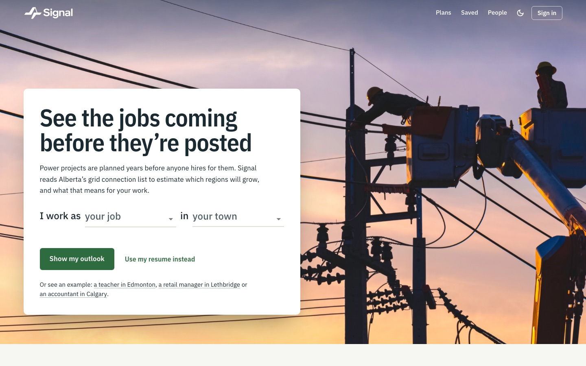
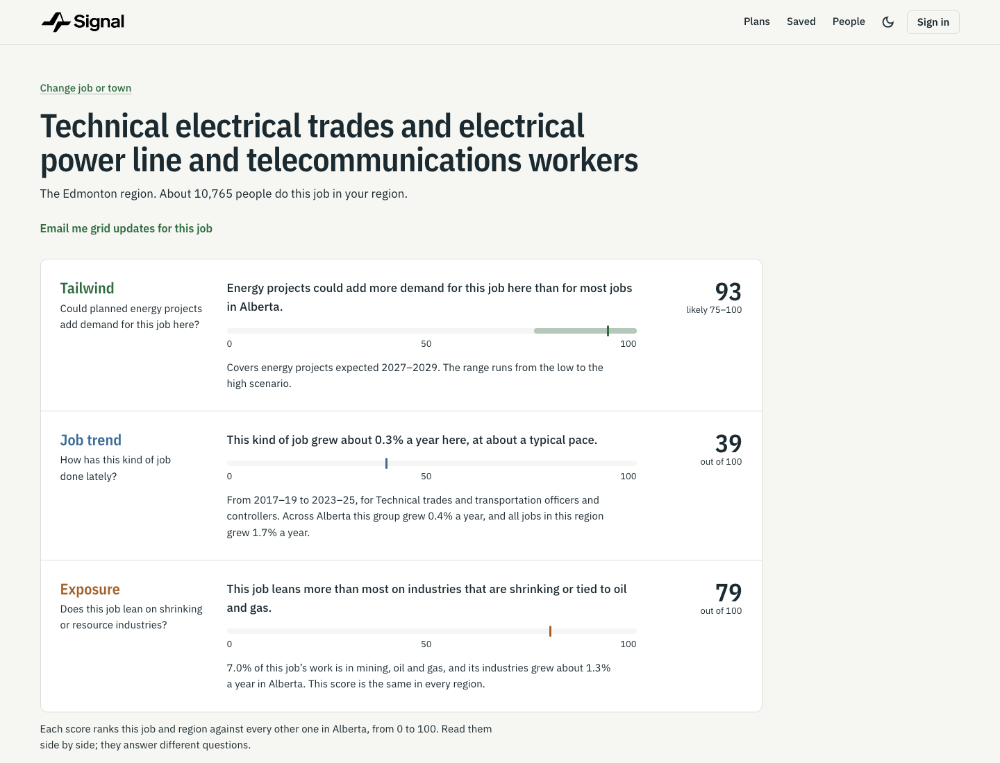

# Signal

**See the jobs coming before they're posted.**

Power projects are planned years before anyone hires for them. Signal reads Alberta's grid connection list to estimate which regions will grow, and what that means for your work.



Every month AESO, Alberta's grid operator, publishes the list of projects waiting to connect to the grid: wind and solar farms, gas plants, batteries, data centres. About 70 GW is in the queue, and we expect about 6 GW of it to get built. Signal works out which projects are likely to be built, turns the spending into jobs by region and occupation, and sets that beside how each job has done lately. Tell it your job and town, or upload a resume, and it shows your outlook, the roles you could move into and a plan for getting there.

## What it shows you

Pick one of 162 jobs and one of 66 towns. Signal gives three scores. Each ranks that job and region against every other one in Alberta, from 0 to 100.

| Score | The question it answers | Where it comes from |
|---|---|---|
| **Tailwind** | Could planned energy projects add demand for this job here? | Projects expected 2027–2029, weighted by the chance each one is built and turned into direct, indirect and induced jobs. Shown with a range from the low to the high scenario. |
| **Job trend** | How has this kind of job done lately? | Statistics Canada's Labour Force Survey: the job's growth across Alberta from 2017–19 to 2023–25, adjusted for how all jobs in the region grew. |
| **Exposure** | Does this job lean on shrinking or resource industries? | How much of the job's work is in mining, oil and gas, and how fast its industries grew. The same in every region. |



## What else it does

- **Start from your resume.** Upload a PDF, Word or text file to get the closest jobs and the skills that matched. Signed in, you can keep it on your account and download or delete it from **Saved**.
- **Roles you could move into.** Nearby jobs with a stronger tailwind in your region, matched on how much their industries overlap.
- **Energy activity.** A map and list of the projects on AESO's list, by region and type. Pick one to see which occupations that kind of project employs in the region. AESO's list has no site coordinates, so pins mark the region, not the exact site.
- **Plan my next steps.** A Gemini career advisor turns your results, experience, study time, budget and learning preference into an action plan: skills to look into, links from a reviewed resource catalog and introduction drafts you send yourself. Ask follow-up questions, then save the plan and tick off steps under **Plans**.
- **Grid alerts.** Follow a job and region and get a monthly email when AESO's list changes there: new projects, ones moving ahead, coming sooner, delayed, put on hold or no longer waiting, plus outlook moves of 5 points or more. No changes, no email. The Alerts page previews the next one.
- **Saved pathways and people.** Save the moves you're weighing. Share one, and people in your region looking at the same move can ask you for an introduction by email. They see only your first name and the move.

## How it works

```
AESO's connection list (monthly)
  -> chance each project gets built          logistic regression, Markov chain for far-off dates
  -> spending in Alberta, year by year       CER costs, share spent in Alberta
  -> direct, indirect and induced jobs       Alberta's economic multipliers
  -> sector and region
  -> occupation                              2021 Census occupation-by-industry mix
  -> Tailwind and roles you could move into
```

Job trend and Exposure come from Statistics Canada employment data, not the grid. Job trend was added so Signal says something about every job, since energy projects barely touch most of them.

Data centres are the big unknown. None on AESO's list has energized yet, so history can't predict them. They get explicit low, base and high odds instead, and make up 78% of the job estimate. Every judgement call is in [config/assumptions.toml](config/assumptions.toml), and [docs/methodology.md](docs/methodology.md) walks through each step.

On the deployed app this runs again on the 12th of every month: a build fetches AESO's new list, rebuilds the model, runs the tests and checks, and publishes only if they all pass.

## How far to trust it

We backtested everything we could, including the tests that went badly ([docs/validation.md](docs/validation.md)):

| Claim | Evidence | Verdict |
|---|---|---|
| It can tell which queued projects get built | AUC 0.94 to 0.98 on later months | Supported |
| Job order within a region holds when assumptions change | Rank correlation 0.95 or higher | Supported, partly by design |
| Job counts are accurate | 3,300 to 36,000 a year, low to high scenario | Order of magnitude only |
| Tailwind predicts which jobs grow | −0.05 across 34 occupation groups | Not supported |
| Past job trends forecast the next period | Rank correlation 0.15 to 0.29 | Not a forecast |

So Signal is good at saying what gets built, and honest about what that could mean for each job, but there's no evidence yet that it predicts hiring. Grid-driven demand is about 11,000 jobs a year in a workforce of 2.6 million: real for the trades, close to invisible for most other jobs. That's why the scores are ranks with ranges, and why roles you could move into rest on industry overlap, not proven skill transfer.

## Run it locally

The app only needs Node.js 20.19+ (or 22.12+). The model's outputs are committed, so you don't need the raw data, Python or AWS to try it.

```bash
git clone https://github.com/alijaffary603/HTC-1.git
cd HTC-1
npm --prefix frontend install
npm --prefix frontend run dev
```

Open http://localhost:5173 and try one of the examples under the form.

**Plan my next steps** also needs the advisor server, which needs Python 3.11+ and a Gemini API key:

```bash
python -m venv .venv
source .venv/bin/activate            # Windows PowerShell: .venv\Scripts\Activate.ps1
python -m pip install -e ".[dev]"
cp .env.example .env                 # then put your key in GEMINI_API_KEY
python -m gridskills.server          # http://127.0.0.1:8000
```

Vite forwards `/api` requests to it, so keep both running.

### Local mode and the deployed app

With no backend set, the app runs in local mode. The scores are the real model's, and anything that would need a server is kept in your browser instead.

| | Local (`npm run dev`) | Deployed on AWS |
|---|---|---|
| Scores | Real model output, from files in `frontend/public/data/` | The same numbers from the API, refreshed monthly |
| Reading a resume | In your browser; the file never leaves your device | Gemini picks the closest of the 162 jobs |
| Accounts | Kept in this browser | Amazon Cognito, with an emailed code |
| Pathways, alerts, saved resume | Kept in this browser (for a resume, only its name and what was read) | DynamoDB, and a private S3 bucket for resume files |
| People like you | Sample profiles; nothing is sent | Only people who chose to share; introductions go by email |
| Grid alert emails | Preview only: real projects with made-up changes, labelled as such | Sent monthly after the data refresh |
| Advisor | Needs `python -m gridskills.server` and a Gemini key | Runs in its own Lambda |
| Map | Needs `VITE_GOOGLE_MAPS_API_KEY`; the project list works without it | Same |

## Configuration

| Setting | Where | What it does |
|---|---|---|
| `GEMINI_API_KEY` | `.env` | The advisor's key for `python -m gridskills.server`. Git ignores `.env`. |
| `GEMINI_MODEL` | `.env` | Optional. Defaults to `gemini-3.1-flash-lite`. |
| `VITE_API_URL` | `frontend/.env.local` | The AWS API. Unset means local mode. `scripts/deploy.py` sets it to `/api`. |
| `VITE_COGNITO_REGION`, `VITE_COGNITO_CLIENT_ID` | Set by `scripts/deploy.py` | Sign-in through Cognito. |
| `VITE_MODEL_API_URL` | `frontend/.env.local` | The advisor API, only if it's deployed separately (the `deployment/` stack's `ModelApiUrl`). Unset means `/api`. |
| `VITE_GOOGLE_MAPS_API_KEY` | `frontend/.env.local` | Turns on the map. Enable the Maps JavaScript API and billing in Google Cloud, restrict the key to your site and that API, then restart Vite. |
| `VITE_GOOGLE_MAPS_MAP_ID` | `frontend/.env.local` | Optional production map ID. |

Vite builds every `VITE_*` value into the public JavaScript, so never put a secret in one. Gemini keys stay on the server: in `.env` locally, and in SSM Parameter Store on AWS.

<details>
<summary>The advisor's resource catalog and mentor list</summary>

The advisor only links to resources in `config/advisor_resources.json` (reviewed links, the occupation code prefixes they fit and the date each was checked). It only suggests mentors from `config/advisor_mentors.json`, which starts empty. Add real people only with their permission:

```json
[
  {
    "id": "your-profile-id",
    "name": "Consenting person's display name",
    "region": "Calgary",
    "targetCodes": ["7220"],
    "optedIn": true,
    "url": "https://your-approved-profile-page.example/",
    "reason": "Their experience is relevant to this transition."
  }
]
```

To opt someone out, remove them or set `optedIn` to `false`. When no mentor matches, the advisor points to source-linked career coaching instead.

</details>

## Tests

```bash
python -m pytest                     # model, advisor and backend (AWS is faked with moto)
npm --prefix frontend run build      # type-check and production build
npm --prefix frontend run lint
npm --prefix frontend exec -- playwright install chromium   # once
npm --prefix frontend run test:e2e   # browser tests
```

Gemini is mocked in every test, and the few tests that need the raw data skip without it. The browser tests start their own advisor server and Vite on ports 8000 and 5173, so stop any dev servers first. On Windows, set `PLAYWRIGHT_CHANNEL=msedge` to use Edge instead of downloading Chromium.

## Deploy to AWS

The whole app is one CloudFormation stack, [aws/template.yaml](aws/template.yaml):

```
Browser -> CloudFront -> S3: the React app
                      -> /api/* -> API Gateway, which checks the Cognito sign-in where needed
                                     -> API Lambda (backend/gridapi) -> S3 scores, DynamoDB, S3 resumes, Gemini, SES
                                     -> Advisor Lambda (Signal advisor) -> Gemini

12th of each month: EventBridge -> CodeBuild fetches AESO's new list, rebuilds the model, runs the tests and checks
                                -> if they all pass: publish to S3 -> Alerts Lambda -> SES emails
```

```bash
python scripts/deploy.py --sender-email you@example.com --admin-email you@example.com
```

You need the AWS CLI signed in, Node, a Gemini API key and the raw data in `data/`. The script asks for the key if `GEMINI_API_KEY` isn't set and stores it in SSM Parameter Store, never in the template or git. It deploys to `ca-central-1`, builds the frontend against the new API and prints the site URL. Run it again to update; `--skip-data` and `--skip-frontend` skip those steps. Commit before deploying, because the monthly build rebuilds whatever was last deployed. [docs/aws.md](docs/aws.md) covers the SES sandbox, cost and teardown.

Only need the advisor? [deployment/](deployment/README.md) is a smaller SAM stack for just the advisor API.

## Rebuild the model

Only needed if you change the model. Download the raw data into `data/` (sources in [DATA_README.md](DATA_README.md)), then:

```bash
python scripts/extract_census.py     # once; takes a few minutes
python scripts/build_all.py          # rebuilds outputs/
python scripts/validate.py           # backtests
python scripts/sensitivity.py        # how much each assumption matters
python scripts/export_app_data.py    # refreshes the app's data, including the map
```

To score one job from a terminal: `python -m gridskills.api electrician "Fort Saskatchewan"`. [docs/using_the_scores.md](docs/using_the_scores.md) explains the output.

## Repository map

| Path | What's in it |
|---|---|
| [frontend/](frontend/README.md) | The React app (Vite, TypeScript, MUI). Its README covers the layout and the API it expects. |
| `gridskills/` | The model. `api.py` has `score(job, place)`; `advisor.py` and `server.py` run the career advisor. |
| `backend/gridapi/` | The AWS API: scores, resumes, pathways, alerts, grid changes and emails. |
| `aws/` | The CloudFormation template and the monthly build. |
| `deployment/` | A separate, advisor-only SAM stack. |
| `scripts/` | Build, check and publish the model, export the app's data, deploy. |
| `config/` | Model assumptions, CER costs, the advisor's resource catalog and mentor list. |
| `outputs/` | Model results, committed so nobody needs the raw data. |
| `tests/` | pytest suites for the model, advisor and backend. |

## Docs

| Doc | What it covers |
|---|---|
| [docs/methodology.md](docs/methodology.md) | How a queued project becomes a job score, step by step |
| [docs/validation.md](docs/validation.md) | What we tested against real outcomes, including what failed |
| [docs/using_the_scores.md](docs/using_the_scores.md) | Calling `score()` and reading its output |
| [docs/code_guide.md](docs/code_guide.md) | What each code file does |
| [docs/aws.md](docs/aws.md) | The AWS setup, deploying, privacy and cost |
| [DATA_README.md](DATA_README.md) | Raw data sources and how to rebuild |
| [Signal_workflow.md](Signal_workflow.md), [Team_split.md](Team_split.md) | How we planned and split the work |

## Privacy

- **Resumes.** In local mode the file never leaves your browser. On the deployed app it goes to Google's Gemini API to be read, and the upload screen says so. Signed-in people can keep one resume on their account (on by default, shown before they choose a file). Deleting it on the Saved page removes the file and its record.
- **The advisor** sends your skills, preferences, question and recent messages to Gemini only after you tick the box. It takes the model's numbers from the server, not the browser, and rejects plans that cite resources outside the catalog.
- **Sharing** is off until you turn it on. An introduction request reveals the requester's email only as the reply-to address.
- **Storage.** Accounts, pathways, alerts and saved resumes stay in AWS's Canada (Central) region, `ca-central-1`.

## Team

Built by four people for a hackathon.

| | Role | What they built |
|---|---|---|
| Uzair | Model and data | The Signal model and its validation, the AWS backend and the monthly refresh |
| Ali | Product | The web app, and the accounts, saved resumes and grid alerts behind it |
| Abdullah | AI and data | The Gemini career advisor and action plans, the energy activity map, the Signal rebrand |
| Ahmed | Design and story | The Signal logo and brand, layout design and the pitch |

The product is Signal. Internal Python module names, AWS resource names and browser storage keys are retained for compatibility with existing scripts, deployments and saved data. Keep the module names and paths in the commands above as written. The Python distribution is `signal-careers` and the frontend package is `signal-web`.

## AI use disclosure

We used AI assistance for parts of the frontend, including the Gemini API and Google Maps API integrations.
